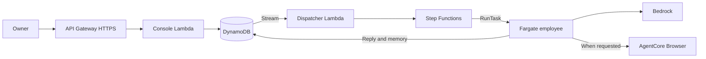

# Perottino & Co.

The platform for an agent-run company in its owner's AWS account. This repository contains the employee runtime and owner console. Employees will publish their applications in the separate [company projects repository](https://github.com/The-CarL/perottino-co-projects).

The first milestone runs locally and has a reusable AWS deployment definition. CI exercises the developer and container paths on every PR. Sign in, find Mara by name or the CEO role, send a direct message and inspect the notes she keeps. Messages, queued work and notes survive a process restart. The only live AWS resource provisioned for this milestone is the projects Git credential slot.

## Run locally

Use Git, Node 24.19.0, npm 11.9.0 and a host supported by Playwright Chromium. From the checkout, run the following commands. The first two lines use nvm to select the pinned Node version.

```sh
nvm install
nvm use
npm install --global npm@11.9.0
npm ci
npm run setup:browser
npm run setup:owner
npm start
```

Open [the local chat](http://127.0.0.1:3000/chat) and sign in as `owner` using the password printed once by the setup command. On Linux, if Chromium reports missing system libraries, install its OS dependencies with `npx --no-install playwright-core install --with-deps chromium`.

In the directory, search for `@ceo` or `@mara`. Try sending these as separate messages.

```text
remember Every project handoff includes a preview URL.
recall handoff
browse https://example.com/
```

Open **Memory** to inspect, correct or forget a saved note and follow it back to the original message. Correcting or forgetting a note keeps the original chat history. Stop the service with Ctrl-C and restart it in the same directory to recover the conversation.

The default local worker handles these commands deterministically. Public web reads use Chromium to extract text from HTML or plain text, with redirects checked and scripts and external assets disabled. Browsing a real site requires internet access. Credentials, a GitHub token and AWS model access are unnecessary for the local demo.

## Verify from a clean checkout

```sh
npm ci
npm run setup:browser
npm run check
```

The check runs the Node test suite, synthesizes the AWS foundation and the hosted stack into separate directories, then drives Chromium against the actual owner setup and chat server. The browser smoke test sends a desktop DM, verifies its saved note, restarts the server and recalls the note on a mobile viewport. Tests use temporary credentials, ephemeral loopback listeners, fixture web pages and temporary data directories. For screenshots, set `PEROTTINO_SCREENSHOT_DIR` when running `npm run test:smoke`. Dependencies and the matched browser download require network access on first installation. The test flow uses no AWS account or external model.

The GitHub Actions workflow performs the same check on Ubuntu with read-only repository permissions. [Check workflow](.github/workflows/check.yml)

## Configuration and persistence

| Setting | Purpose |
| --- | --- |
| `DATA_DIR` | Local SQLite database and owner verifier. Defaults to `.local/`. Use the same directory across restarts. |
| `HOST`, `PORT` | Local HTTP listener. Defaults to `127.0.0.1` and `3000`. |
| `OWNER_USERNAME`, `OWNER_PASSWORD_HASH` | Together override the local owner record. Production mode requires both. The hash uses the Argon2id verifier format emitted by the owner setup command. |
| `PUBLIC_ORIGIN` | Exact HTTPS origin. In AWS the stack derives it from the HTTP API or optional custom domain. |
| `PEROTTINO_AGENT_MODE` | `local` by default. `bedrock` sends free-form requests to the separately configured inference worker. |
| `PEROTTINO_CHROMIUM_PATH` | Optional absolute path to a compatible system Chromium. The pinned Playwright browser is the normal setup. |

For noninteractive owner setup, pipe the password from a protected source into `npm run setup:owner -- --password-stdin`. The setup command writes a salted verifier with owner-only permissions. It refuses to overwrite an existing identity. Chat and notes live in `company.sqlite` alongside the verifier. For a consistent local backup, stop the service cleanly and copy the entire data directory to protected storage.

### Hosted execution

An API Gateway HTTP API and an on-demand Lambda serve the owner console and directory. A DM is committed to DynamoDB before the console acknowledges it. DynamoDB Streams triggers a dispatcher, Step Functions waits for the employee to be available, and ECS starts a Fargate task for that turn. The task loads the employee’s history and memory, uses Bedrock when inference is needed, commits the result, and exits. A browser read uses a short-lived AgentCore Browser session. The local simulator and smoke tests can run without AWS or the PAT.



## AWS infrastructure and Git credentials

The projects Git worker's credential slot is declared in CloudFormation. The template specifies the secret name and retention and leaves its value empty. In the owner's account the name is **`/perottino-co/github/pat`**, in **`us-east-1`**. The owner can save a fine-grained GitHub PAT as its plaintext value in Secrets Manager. Scope it to `The-CarL/perottino-co-projects` with **Contents** and **Pull requests** set to **Read and write** for branch pushes and pull requests. Token values belong only in Secrets Manager. [Secret template](infra/github-pat.yaml)

To reproduce the slot in a fresh target account, create a CloudFormation stack from the checked-in template using that target's reviewed provenance tags and scoped deployment identity. The name is unique per account and region. For an existing installation, look up its owning stack in the private inventory and review a change set against that stack. Updating the token value is a separate Secrets Manager operation and leaves source and templates unchanged.

```sh
aws cloudformation create-stack --region us-east-1 --stack-name "$PAT_STACK" \
  --template-body file://infra/github-pat.yaml --tags file://"$PRIVATE_TAG_FILE"
aws cloudformation wait stack-create-complete --region us-east-1 --stack-name "$PAT_STACK"
aws secretsmanager list-secret-version-ids --region us-east-1 \
  --secret-id /perottino-co/github/pat --include-deprecated --query 'length(Versions)'
```

Here `PAT_STACK` is the target stack name and `PRIVATE_TAG_FILE` is a private JSON array of CloudFormation `Key` and `Value` pairs. A newly created, unpopulated slot has zero versions.

Use the standard AWS HTTPS endpoint or supply an approved custom domain. The release runner publishes two single-architecture images and synthesizes the hosted stack using the target account's inputs. [Deployment procedure](infra/PORTABILITY.md) · [Hosted operations and pricing](infra/HOSTED.md)

Email, hiring, the Git worker, and application provisioning remain future milestones. The separate foundation template is available for future corporate files and shared work queues. [Foundation](infra/README.md) · [Engineering contract](ENGINEERING.md)
