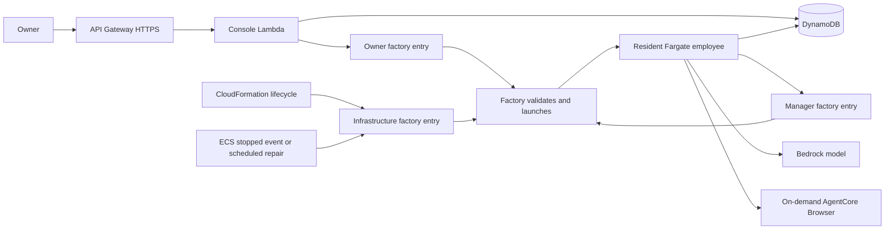

# Hosted company

Each active employee runs as a standalone Fargate task. The factory creates the CEO when the stack is commissioned. A successful hire receives a durable employee identity before its own task starts. The owner can contact the CEO through the HTTPS console and pause the company through the factory. DynamoDB stores the directory, reporting relationships, work, memory and lifecycle records. A replacement process can resume the same employee's work.



The pilot starts with one CEO. Its default limit of **100 employees** leaves room for 99 hires. The configured cap governs personnel, while actual monthly cost also depends on worker size, active hours, model calls and tools. Running a resident Fargate task incurs compute, memory and public IPv4 charges throughout its lifetime, including when its queue is empty. A 30-second idle pulse amounts to about 87,600 pulses per employee in a 730-hour month; a pulse may perform several DynamoDB operations. Empty pulses leave model inference and browser sessions idle. The factory's five-minute repair rule runs about 8,760 times over the same month. [Account setup and cost assumptions](PORTABILITY.md)

The hosted template provisions application traces, low-cardinality metrics, an operations dashboard and a failure alarm. The application emits spans during active work. Local development supports an optional OTLP receiver. [Telemetry and operator queries](TELEMETRY.md)

## Account and region inputs

From a checkout at the reviewed revision:

```bash
npm ci
npm run synth:hosted
npm run synth:hosted -- --config /private/hosted.json --provenance /private/provenance.json --outdir /private/assembly
node --test --test-isolation=none test/infra-hosted.test.mjs
```

The default synth uses [synthetic target values](example-hosted.json) and [synthetic provenance](example-provenance.json). The private synth emits a compact `Hosted.template.json` and its account-specific assembly. The application writes its operational state to the table in this stack. The separate foundation template covers additional corporate infrastructure.

| Input | Required target information |
| --- | --- |
| `account`, `region` | AWS commercial account and region with Fargate, Lambda container images, API Gateway, DynamoDB, the selected Bedrock profile and AgentCore Browser available. |
| `vpcId`, `publicSubnetIds` | Existing public subnets in this VPC with an internet-gateway route, functional VPC DNS and appropriate network ACLs. The factory assigns a public IP to each resident. The security group has outbound TCP 80/443 and no ingress rules. Multiple AZs give Fargate more placement options. |
| `lambdaImage`, `workerImage` | Distinct, digest-pinned Linux x86_64 images in one private ECR repository in the target account and region. The runtime-bootstrap stack grants the scoped Lambda functions image retrieval. The Fargate execution role pulls the employee image and delivers logs. |
| `ownerSecretArn` | Full ARN of the target's Secrets Manager secret containing `username` and a salted Argon2id `passwordHash`. The bootstrap uses service-managed encryption. For customer-managed encryption, review decrypt access on the exact key before use. |
| `permissionsBoundaryArn` | Approved IAM boundary in the target account. Hosted roles use the project path `/factory/<scope>/` and this boundary. |
| `bedrockModel`, `bedrockResourceArns` | Exact supported inference profile ID, source-region profile ARN and permitted destination model ARNs. The pinned adapter accepts `us.openai.*` and `global.openai.*`. Validate model availability, destination regions and actual live authorization in the selected account. AgentCore Browser uses the regional system tool `aws.browser.v1`. |
| Optional `employeeLimit` | Integer from 1 through 100, default 100. The factory bootstraps the CEO once. Increasing the limit makes additional hires possible. Review existing staff and outstanding launch reservations before lowering it. |
| Optional `workerSize` | `small` (default) is 0.25 vCPU and 1 GiB per active employee. `medium` is 0.5 vCPU and 1 GiB. `large` is 1 vCPU and 2 GiB. Profile task memory, pulse time and inference latency before increasing fleet-wide sizing. |
| Optional `customDomain` | Supply a public `hostname` and an issued regional ACM `certificateArn` for that name. Supply `hostedZoneId` to create one Route 53 A alias. With external DNS, use the `RegionalDnsName` and `RegionalDnsZone` outputs. The default public address is API Gateway's managed HTTPS endpoint. Configuring a custom domain disables that default endpoint. |

The stack name remains `factory-<scope>-r-events`. The `State` logical ID and its string `pk`/`sk` schema remain stable. Lambda names append `a`, `f`, `o` and `m` to `factory-<scope>-r-` for the web API, infrastructure factory, owner factory and manager factory respectively. The project scope must fit in 52 characters. The public email adapter, when separately enabled, uses its own release and permissions. Output `StateTableName` identifies this stack's table.

Supply full factory stack tags, preserve immutable creation attribution on subsequent releases and read back physical IDs and resource-specific tags. Check the ECR repository's `factory:s` and `perottino:purpose=runtime-images` and the owner verifier's corresponding scope and `perottino:purpose=owner-verifier`. The hosted role policies enforce those tags when pulling worker images or reading the verifier. Durable table data and 14-day CloudWatch Logs groups are retained across replacement and deletion. Enable termination protection on the CloudFormation stack when deploying the synthesized template directly.

## Lifecycle and trust

- **Deployment.** CloudFormation's `Custom::ResidentCompany` calls the infrastructure factory on creation, update and deletion. Deployment authorization includes starting a billable CEO. A successful creation callback confirms the durable intent and ECS launch acceptance. Verify that ECS reaches RUNNING, the bound generation records a pulse, and the CEO answers an actual message. CloudFormation, factory-specific `lambda:InvokeFunction`, IAM role creation and constrained `iam:PassRole` are among the deployment permissions. `CAPABILITY_IAM` is sufficient for this hosted stack. Prepare the ECS service-linked role and long ARN formats where an account restricts their creation.
- **Identity.** The ECS task definition and application image are shared. The factory binds each launch to an employee ID, generation, company execution epoch and per-run capability. Protect access to ECS task descriptions, launch requests, provider audit records and factory storage, which may expose sensitive launch overrides. The resident passes only its own identity to the corporate tools. Model prompts, chat and employee memory must never receive a capability. The factory checks the current binding, authority and direct-report relationship before applying management actions.
- **Access boundaries.** Web and employee roles use separate owner and manager broker entry points. Both roles send traces to X-Ray, and the worker calls its model and browser. The factory role authorizes company commands against the actor and the current task binding, and reads or writes the corresponding DynamoDB partitions. Factory-private records and the company's versioned work records are accessible only through the broker from these clients. The web role reads the designated owner verifier. The future Git worker owns projects credential access.
- **Continuity.** A STOPPED event for a task in an `employee-` group sends only the group, task and cluster ARNs, and stopped status to the infrastructure handler. A five-minute reconciliation pass covers delayed events, interrupted launches and drift. The factory must verify durable desired state and binding before replacing a resident. Repeated STOPPED events for an old generation leave its successor in place. Repeated launch failures use backoff and block after five unsuccessful attempts. The factory reuses a stable ECS client token for ambiguous starts and looks up its started-by token before replacing an uncertain launch; investigate blocked placement or image pulls before resetting that employee. To stop a resident intentionally, change its desired state through the owner controls; manually stopping an active task triggers normal recovery.
- **Release and recovery.** Keep the prior image digests, configuration and table recovery references. A stack update passes the new task definition, image, subnet placement and seat limit to the factory. Company-wide suspension is durable across ordinary updates. Scope a release's new generations to the intended changed runtime; the directory, pending work and memories survive task replacement. CloudFormation resource dependencies keep the control functions, roles and task definition available while draining a deleted stack. Review and reconcile any failed custom-resource callback before retrying.
- **Operator pause.** The HTTPS owner console controls individual employees. For a company-wide pause, invoke the Lambda identified by the `OwnerFactoryArn` stack output with `{"operation":"pause-company","requestId":"<new UUID>"}` using an AWS identity authorized for `lambda:InvokeFunction` on that ARN. Reuse the same request ID to reconcile an ambiguous response. Verify the company's suspension record, stopped workers and absence of replacement launches after repair. A launch already accepted by ECS can briefly incur charges while it drains. After review, `{"operation":"resume-company","requestId":"<different UUID>"}` resumes eligible employees. A pause and a stack deletion have distinct lifecycle semantics. Stack deletion persists the deployment stop before draining, preventing scheduled or late STOPPED events from reactivating the company.
- **Retiring task definition revisions.** CloudFormation retains each replaced worker task definition revision and the final revision on stack deletion. A registered revision is configuration and accrues no Fargate compute charges. The factory’s existing drain procedure stops running employees. Record each revision ARN and its image digest in the private release inventory. After verifying that a revision has no running or pending tasks and its rollback window has closed, include the exact revision in the owner-approved cleanup plan. An operator authorized for `ecs:DeregisterTaskDefinition` can then deregister that revision explicitly.
- **Incidents.** Check the task binding and desired state, ECS task status and stopped reason, factory errors and the latest employee pulse. A task can remain RUNNING and billable while its application is unresponsive. Reconciliation uses ECS task status. A stale pulse calls for investigation and an owner-authorized pause or restart. Do not print ECS container overrides in diagnostics. After a partial launch, reconcile the existing request token and task before retrying. During an image/role/network failure, pause the affected employee or company to control costs while fixing the cause. Verify a fresh generation claims prior work without duplicating a hire, reply or artifact. For a failed restore, retain existing table and backup references. Restore DynamoDB PITR into a separate table, verify company state, unique handles, hire receipts, task generations, pending work and memories, and keep the old workforce paused before switching the data source. A restored binding for a terminated task requires factory reconciliation.
- **Upgrading an earlier deployment.** If an earlier per-message workflow stack was actually deployed, first stop new submissions and reconcile in-flight workflows, failed deliveries and leased turns against the existing table. Review removal of the old stream mapping and state machine, and check separately retained failure stores. Clean up only inventoried resources under an approved plan. The resident architecture starts billable tasks as part of the new release. Provider quotas, production model calls, browser sessions, lifecycle retirement, cross-account restoration and actual billing must be verified in the chosen account.
