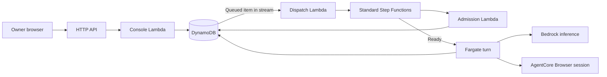

# Event-driven hosted runtime

The owner uses an API Gateway HTTPS URL to open the company console. A Lambda function serves the UI and authenticated API. Sending a message commits the conversation entry and work item together in DynamoDB. The HTTP response acknowledges that write. The reply arrives in the same conversation after a Fargate task has committed it. Employees waiting for work have no running compute.



The AWS-managed DynamoDB Streams event source mapping reads the stream. The application runs no polling service, EC2 host, ECS service, load balancer, NAT gateway, EBS volume or filesystem. The owner UI polls every 60 seconds while visible and idle, every 2.5 seconds for pending work, and pauses when hidden. Each warm API environment caches the owner verifier for at most 30 seconds. Durable AWS storage, secrets and retained images still have costs between turns. [Account release and costs](PORTABILITY.md)

## Deployable inputs

```bash
npm ci
npm run synth:hosted
npm run synth:hosted -- --config /private/hosted.json --provenance /private/provenance.json --outdir /private/assembly
node --test --test-isolation=none test/infra-hosted.test.mjs
```

The default synth uses [synthetic configuration](example-hosted.json) and [synthetic provenance](example-provenance.json). The private synth produces its own CDK assembly and compact `Hosted.template.json`. The hosted stack includes the durable table it actually uses. An independent foundation template is available for future company-wide storage and messaging.

| Input | Use |
| --- | --- |
| `account`, `region` | Destination commercial AWS account/region. Verify that Fargate, Lambda container images, API Gateway, DynamoDB Streams, Standard Workflows, the selected Bedrock inference profile and AgentCore Browser are available there. |
| `vpcId`, `publicSubnetIds` | One or more existing public subnets in that VPC. Each must route to an internet gateway and provide working VPC DNS. The task gets a temporary public IPv4 address, ingress is closed and the task security group permits outbound TCP 443. Select subnets in multiple availability zones for placement options. |
| `lambdaImage`, `workerImage` | Distinct digest-pinned Linux x86_64 images in the same target-account and target-region private ECR repository. The Lambda image contains the console and dispatch handlers. The worker image contains the Codex SDK and turn runner. The bootstrap's ECR policy must allow Lambda's service principal to retrieve images for the four exact project function names. |
| `ownerSecretArn` | Full ARN of the destination Secrets Manager secret holding `username` and the salted Argon2id `passwordHash`. Use the account bootstrap's service-managed encryption. The Git credential has a separate lifecycle and no task or function in this stack can retrieve it. |
| `permissionsBoundaryArn` | Existing approved application-role boundary in the target account. All seven execution/runtime roles use `/factory/<scope>/` and this boundary. Only the API role reads the owner secret. The Fargate execution role pulls the pinned image and writes logs. The employee role can access company records, the approved model resources and the system browser. |
| `bedrockModel`, `bedrockResourceArns` | Exact supported Codex Bedrock profile ID and ARNs for that profile and its destination foundation models. The adapter accepts `us.openai.*` and `global.openai.*` profile IDs. Verify the model's actual regional destinations, account access and IAM restrictions. AgentCore uses the regional built-in `aws.browser.v1` tool with session start, automation stream and stop permissions. |
| Optional `workerSize` | `small` (default) uses 0.25 vCPU and 1 GiB. `medium` uses 0.5 vCPU and 1 GiB. `large` uses 1 vCPU and 2 GiB. The workload performs inference on Bedrock and rendering on AgentCore. Record task CPU, memory and elapsed time before increasing a target's size. |
| Optional `customDomain` | Supply `hostname` and the ARN of its issued ACM certificate in the same account and region. If supplied, `hostedZoneId` lets the stack create a Route 53 A alias. Otherwise, use the `RegionalDnsName` and `RegionalDnsZone` outputs at your DNS provider. A configured custom domain disables the default API endpoint. With no custom domain the `Url` output is immediately the AWS-managed HTTPS origin. |

The stack name is `factory-<scope>-r-events`. Lambda physical names append `a`, `d`, `i` and `t` to `factory-<scope>-r-` for the API, dispatcher, admission and terminal functions. Choose a factory scope of at most 52 characters to meet Lambda's 64-character function-name limit. Retain original creation attribution and set resource-specific latest-change tags through provenance overrides. Read back the bootstrap repository's `factory:s` and `perottino:purpose=runtime-images` tags and the owner secret's matching scope and `perottino:purpose=owner-verifier` tag. These are enforced during employee-image pulls and owner-secret reads. Record exact physical IDs, child resources, tasks, service-managed rules and optional DNS changes in the private account inventory.

Review the target role's permissions for CloudFormation, IAM role creation/pass with the approved boundary, Lambda, API Gateway, ECS, security groups, Step Functions, EventBridge, DynamoDB, S3, SQS, CloudWatch Logs and optional DNS. The state machine needs the shared AWS integration rule `StepFunctionsGetEventsForECSTaskRule` to monitor `ecs:runTask.sync`. Check existing ECS service-linked role and long ARN settings. The template creates no named IAM roles, so `CAPABILITY_IAM` is sufficient. The private release procedure supplies stack tags and enables termination protection. CloudFormation schemas and synthesis cannot verify account-level restrictions, model availability or subnet routing.

## Ordering, billing and failure bounds

A queued turn is durable even if dispatch is delayed. The stream mapping starts at `TRIM_HORIZON`, selects compact `PENDING#` markers with `kind=job` in the queued state and uses partial-batch reporting and bisection. The dispatcher verifies INSERT, extracts the two IDs and starts a Standard execution named `turn-<jobId>`. Repeated delivery of that immutable turn resolves to the same execution. Its input contains only `agentId` and `jobId`.

Admission uses strongly consistent reads to check the oldest pending turn and any active lease for the employee. Ready work can launch a Fargate task. While blocked, the state machine waits 5 seconds for the first two checks, 20 seconds for the next four and 90 seconds thereafter, up to 240 wait cycles. At most three launches occur per execution. Each launch has a 10-minute outer limit including placement and image pull. The worker claims a fenced 150-second lease and bounds a turn to 120 seconds. A stopped or nonzero-exit task re-enters admission after a short wait. A zero-exit task also re-enters admission. A successful workflow requires a committed reply. A missing or errored turn fails the workflow.

Failures that exhaust the workflow's budget invoke a conditional terminal update. It can fail queued work or a turn whose lease expired, preserve a previously committed reply, or report an active lease. The workflow rechecks an active lease up to four times at 90-second intervals. It then writes a recovery record to the failure bucket rather than overwriting live work. An outer 10-hour timeout provides a final limit. A managed EventBridge status rule sends failed, aborted and timed-out execution IDs to the encrypted recovery queue for up to 14 days. There is no continuously running queue consumer.

The browser runs outside Fargate in an on-demand AgentCore session. A turn that does no browser work starts no browser session. Worker credentials stay in the Fargate task. Only explicitly enabled model/browser operations are in scope; a generated-code sandbox, recruiting, email and Git worker require their own implementation and IAM.

## Operator recovery

- **Retry a stream launch.** Inspect the `FailedEventBucket` output. Lambda writes a full invocation record there after the configured stream retry/age limit. The filtered pending marker contains the IDs and sequence. The separate turn record retains message content in DynamoDB. Treat failure receipts as private operational records. Verify account, state machine, original event and durable job. Parse the S3 object as JSON, parse its `payload` field as JSON when encoded as a string, and invoke the dispatcher synchronously with the original `Records` envelope. Confirm `batchItemFailures` is empty. Look up the deterministic execution and job state. A duplicate name also acknowledges an already-closed execution.
- **Recover an interrupted workflow.** Inspect the recovery queue record, Standard execution history and the turn in DynamoDB. Standard execution names are held for 90 days. Replaying an acknowledged stream INSERT cannot restart a closed execution. For eligible unsuccessful Standard executions use the provider's redrive operation after correcting the failure. For an execution that cannot be redriven, use the terminal Lambda with the exact original `{"agentId":"…","jobId":"…"}` on the approved target. Respect an `active` result and recheck after lease expiry. A committed reply returns `done`. A safely failed turn returns `failed` and releases its pending position. Submit a fresh request with a new client request ID when the owner needs the failed work attempted again. Delete the recovery-queue message only after confirming the durable outcome.
- **Reconcile after an outage.** Check DynamoDB Streams `IteratorAge`, Lambda invocation errors and `DestinationDeliveryFailures`, Step Functions failed/aborted/timed-out executions, recovery queue depth and ECS stopped reasons. The stream retains 24 hours. If a mapping or a failure destination remained unavailable beyond its retention, reconcile pending `PENDING#` entries against their `TURN#` and request records. Start the deterministic execution for an unlaunched job from the original verified IDs, or recover its existing execution as above. The S3 `workflow-failures/` prefix holds IDs that the terminal-write path could not settle. Event notifications supplement the durable ledger and workflow history.
- **Restore records or move accounts.** The retained table has deletion protection and point-in-time recovery. Restore into a new table and verify directory, turn, pending, memory and idempotency records before any cutover. A restore does not replay historic insert events. Reconcile unfinished turns, reconfigure adapters and the stream mapping for the restored table, and stop the old writer before directing traffic to the new one. Preserve exact prior data, backup, secret and image references. Moving to another account also needs destination-owned images, owner credentials, deployment identity, VPC configuration, model access and approved data transfer. A previous SQLite implementation, if operated independently, requires explicit data migration before switching the owner endpoint.
- **Verify an account release.** Open the `Url` output over HTTPS, sign in, send an original DM, inspect its history and model reply, request a public-page read and correct a memory. Check the task has stopped and a later fresh task sees the correction. Record observed launch latency, costs, image digests and recovery evidence. Provider acceptance remains separate from unit tests, image probes and template validation.

The S3 bucket, DynamoDB table, logs and encrypted recovery queue have retention policies. Storage, point-in-time recovery and secrets can continue to incur charges after a stack change. Track them in the approved inventory before cleanup.
